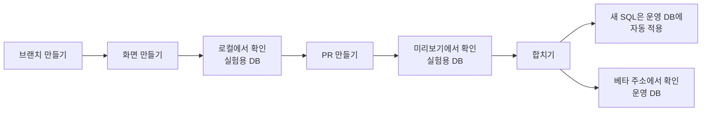

# 작업 흐름

화면을 만들어 베타(https://beta.rallit.co.kr)에 올리기까지의 순서입니다.
대부분의 단계는 Claude에게 말로 요청해서 진행합니다.

## 순서

1. **브랜치 만들기**
   - Claude에게: "main을 최신으로 받고 `feat/match-apply` 브랜치를 만들어 줘"
   - 원본(`main`)에서 바로 작업하지 않습니다. `main`은 보호돼 있어 직접 올릴 수 없고, PR로만 합칠 수 있습니다.
2. **화면 만들기**
   - Claude에게 만들 화면을 설명합니다. Claude는 [AGENTS.md](AGENTS.md)의 규칙을 따릅니다.
3. **로컬에서 확인**
   - Claude에게: "개발 서버를 켜 줘" 그리고 http://localhost:3002 에서 확인합니다.
   - 로컬은 실험용 DB에 연결됩니다. 마음껏 시험해도 실제 사용자에게 영향이 없습니다.
4. **PR 만들기**
   - Claude에게: "커밋하고 PR을 만들어 줘"
   - PR 화면에 나오는 체크리스트를 채웁니다.
5. **미리보기에서 확인**
   - PR 화면의 Vercel 댓글에 미리보기 주소가 생깁니다. 여기도 실험용 DB를 씁니다.
6. **SQL 검사 확인 (새 테이블이나 SQL이 있을 때만)**
   - PR 화면의 `Migrations` 검사가 통과했는지 봅니다. 합치면 이 SQL이 운영 DB에 **자동으로** 적용되기 때문입니다.
   - 실패하면 Claude에게 "Migrations 검사가 실패한 이유를 고쳐 줘"라고 요청합니다.
   - 데이터를 지우거나 바꾸는 SQL이면 검사가 멈춥니다. 관리자와 상의한 뒤 PR에 `운영 데이터 변경 확인` 라벨을 붙입니다.
7. **합치기**
   - PR 화면에서 합치거나, Claude에게 "PR을 합쳐 줘"라고 요청합니다.
8. **베타에서 확인**
   - 1분 정도 뒤에 https://beta.rallit.co.kr 에서 확인합니다. 실제 사용자가 보는 화면입니다.

## 이름 규칙

### 브랜치

- 형식: `종류/작업-내용`. 작업 내용은 영어 소문자를 하이픈으로 잇습니다.
- 예: `feat/match-apply`, `fix/onboarding-nickname`, `docs/setup-guide`
- GitHub 이슈가 있으면 번호를 넣어도 됩니다. 예: `feat/12-match-apply`

### 커밋과 PR 제목

- 형식: `종류: 한국어 요약`. 예: `feat: 매치 신청 화면 추가`
- 한 PR에는 한 가지 기능이나 수정만 담습니다.

| 종류       | 쓸 때                             |
| ---------- | --------------------------------- |
| `feat`     | 화면이나 기능을 추가할 때         |
| `fix`      | 잘못 동작하는 것을 고칠 때        |
| `refactor` | 동작은 그대로 두고 구조만 바꿀 때 |
| `chore`    | 설정이나 도구를 바꿀 때           |
| `docs`     | 문서만 바꿀 때                    |

## 꼭 지킬 것

- **운영 DB에는 시험 데이터를 넣지 않습니다.** 시험은 로컬과 미리보기(실험용 DB)에서 합니다.
- **실제 개인정보를 시험 데이터로 쓰지 않습니다.** "김테스트", "010-0000-0000" 같은 가짜 값을 씁니다.
- **새 개인정보를 받는 화면은 먼저 상의합니다.** 전화번호, 계좌번호, 사진처럼 지금 받지 않는 정보를 받으려면 관리자와 먼저 이야기합니다. 참여자 개인정보 안내문을 함께 고쳐야 합니다.
- **`.env.local`은 커밋하지 않습니다.** 올라가면 CI가 실패합니다.

자세한 규칙은 [AGENTS.md](AGENTS.md)의 "데이터와 Supabase"에 있습니다.

## 막혔을 때

- 화면의 오류 문구나 터미널 메시지를 그대로 복사해서 Claude에게 물어봅니다.
- PR의 검사(CI)가 실패하면 Claude에게 "CI가 실패한 이유를 고쳐 줘"라고 요청합니다.
- 그래도 안 되면 관리자에게 PR 주소와 함께 알려 주세요.

<!-- Migrations 검사 시험용 변경 -->
